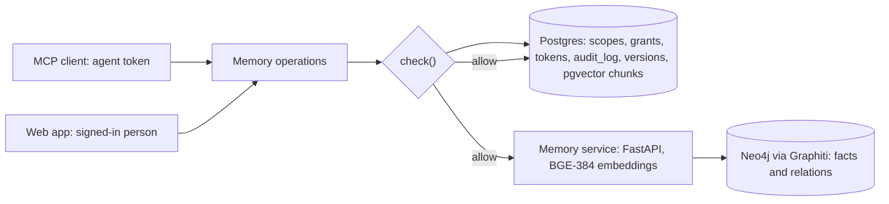
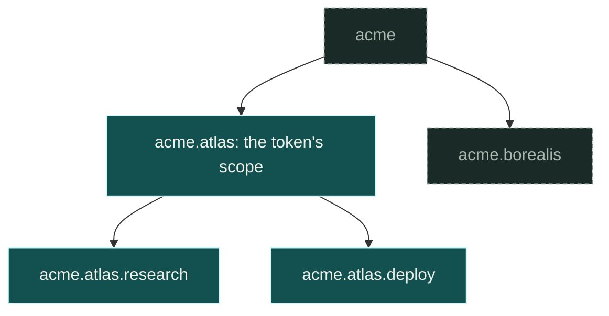
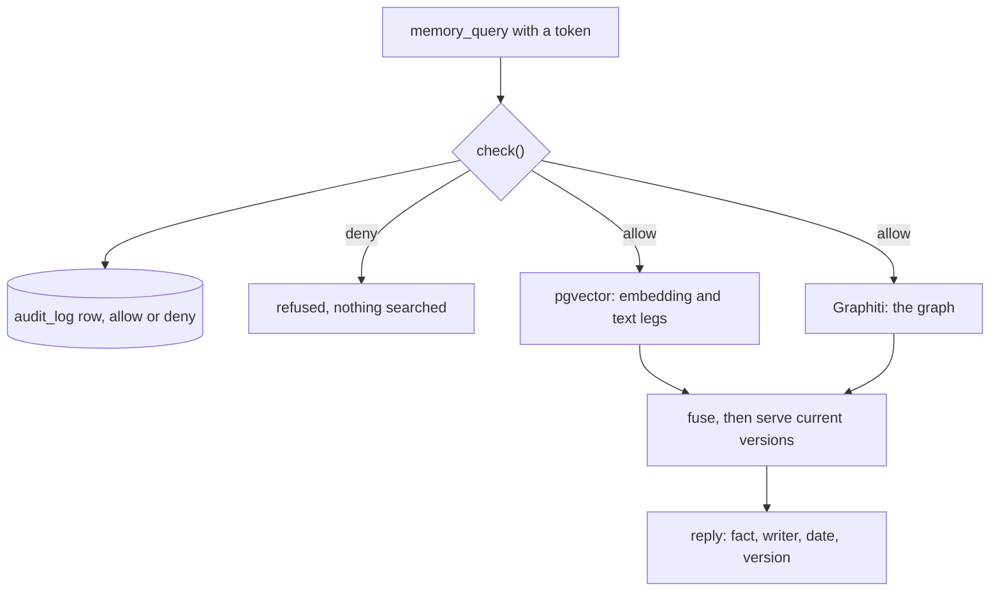
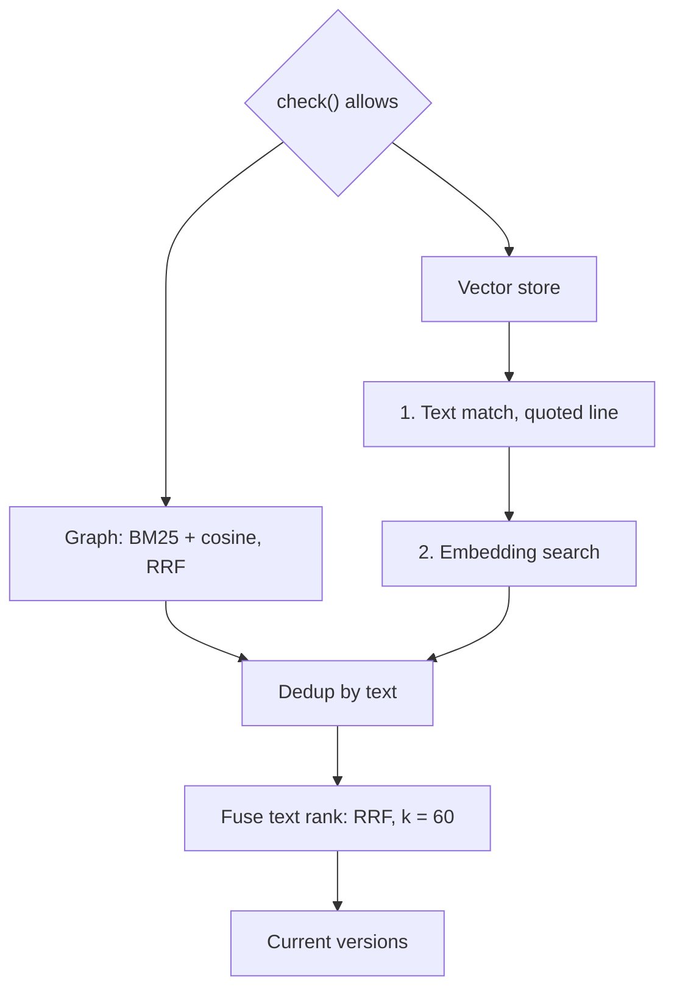
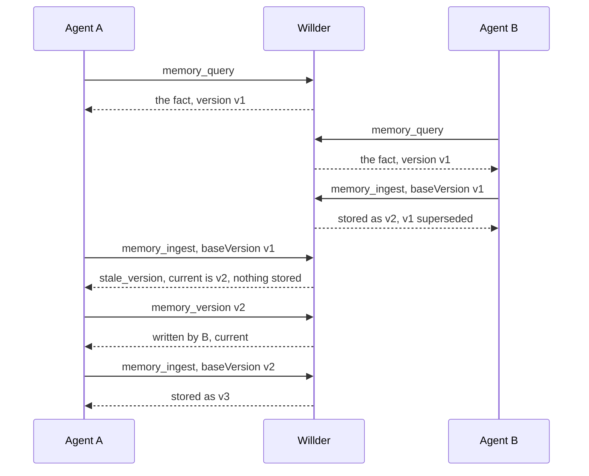
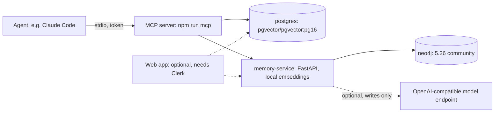
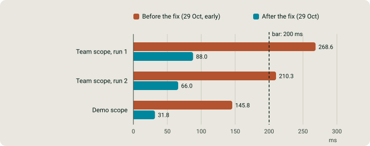
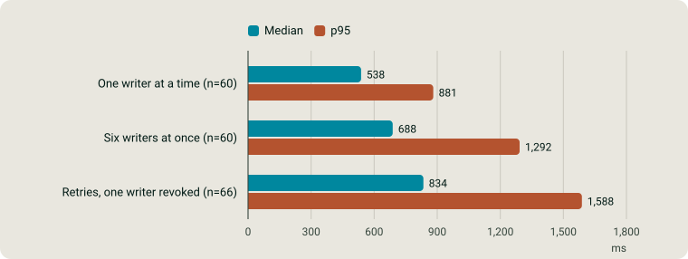
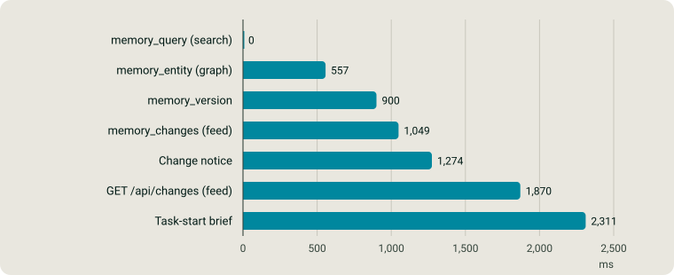
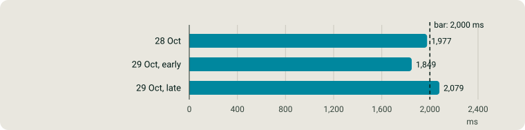

# Architecture

How Willder is put together: the stores, the one access check every guarded read and write
passes, how a read finds and ranks memory, how versions and conflicts work, what deletion and
erasure reach, what is recorded, how it runs on your own machine, and what was measured. Each
section names the files that make it true, so any sentence here can be checked against the code.

- [Overview](#overview)
- [Components](#components)
- [Access model and the single check](#access-model-and-the-single-check)
- [Hybrid retrieval](#hybrid-retrieval)
- [Versions and conflicts](#versions-and-conflicts)
- [Deletion and erasure](#deletion-and-erasure)
- [Change notices and task-start briefs](#change-notices-and-task-start-briefs)
- [Audit and provenance](#audit-and-provenance)
- [Self-host topology](#self-host-topology)
- [Performance](#performance)
- [Limits](#limits)

## Overview

Agents and people reach memory through two doors: the MCP server, with a scoped, expiring
capability token per agent, and the web app, with a signed-in session. Both doors call the same
memory operations, and every guarded operation passes `check()` before any store is touched. An
allowed read asks every store the account tier allows, in parallel, and fuses what they return;
a write is stored, versioned and announced to the other agents on their next tool call.

## Components

| Component | What it holds or does | Where |
|---|---|---|
| Postgres with pgvector and `ltree` | Orgs, scopes (an `ltree` tree), grants, capability tokens (hashes only), the audit log, fact versions, rules, the change feed, working notes, and memory chunks with 384-dimension embeddings | `prisma/schema.prisma`, `services/memory/pgvector-store.ts` |
| Neo4j through Graphiti | Temporal facts and relations extracted from writes, one partition (`group_id`) per scope path | `memory-service/app/graphiti_client.py`, `services/memory/graphiti-store.ts` |
| Memory service (Python, FastAPI) | Owns Graphiti and Neo4j, embeds text locally with BGE-small-en-v1.5 (384 dimensions, shared with pgvector), extracts facts on writes through an OpenAI-compatible endpoint when one is configured | `memory-service/app/main.py`, [memory-service/README.md](../memory-service/README.md) |
| MCP server | The agent door: Streamable HTTP at `/api/mcp` in the web app, or a local stdio server (`npm run mcp`). Both register the same tools | `mcp/server.ts`, `app/api/mcp/route.ts`, [mcp/README.md](../mcp/README.md) |
| Web app (Next.js) | The people door: sign-in, scopes, grants and tokens, the audit view, sources, briefs. Optional for self-hosting | `app/`, [development.md](development.md) |
| Access layer | `check()`, grants, capabilities, audit writes | `services/access/` |
| Memory layer | The guarded store, the hybrid store, versions, conflicts, change notices, task-start briefs, erasure | `services/memory/` |

Writes from connected sources and uploads go through the same ingest path as an agent's write:
names are normalized to one entity before the graph sees them, long content is distilled into
short facts, and the result is written to the graph and to pgvector (`lib/inngest.ts`,
[willder_memory_hybrid.md](willder_memory_hybrid.md)).

## Access model and the single check

Scopes form a tree stored as Postgres `ltree` paths. A grant or a token on a scope covers that
scope and everything under it, and nothing above or beside it.

"Does this grant cover that scope?" is one operator, `granted_path @> target_path`.

Every guarded memory operation calls `check(context, { action, scope })` in
`services/access/check.ts`. It is a database query, with no model in it, and the default is
deny:

- **A person** is allowed when one of their grants covers the target scope with the permission
  the action needs.
- **An agent** is allowed when its capability token (looked up by `SHA-256(token)`; the raw
  token is shown once and never stored) is not revoked, has not expired, is scoped to the
  target or an ancestor of it, and carries the permission. Tokens default to 7 days and are
  capped at 90, and a token with admin permission lasts at most 2 hours. Only a person can
  issue a token, of any permission, so an agent cannot mint or extend its own
  (`services/access/issue-capability.ts`).

Each decision, allow or deny, writes one `audit_log` row with the actor, action, target scope,
decision and reason. The check runs before any store is searched, so out-of-scope data never
reaches the agent, the model or the prompt.

Two things are deliberately outside the check. A request with a missing or unknown token is
turned away with HTTP 401 before any tool runs, unrecorded: there is no org to record it
against. An expired or revoked token gets the same 401 and a `capability.refused` audit row in
its own org. And the check runs inside the application, so a
credential that talks to the stores directly (the database URL, the Neo4j credentials, the
memory service key) reaches memory without it; the README's
[credentials table](../README.md#credentials-that-bypass-the-authorizer) lists each one.

A connected source takes the access of the scope it lands in, not its own sharing list.
Connecting one where more people or any agent could read it is refused until the person
acknowledges exactly what it adds, and that acknowledgement is recorded
(`services/access/source-widening.ts`).

## Hybrid retrieval

A general memory read is hybrid: it asks every store the account tier allows, in parallel, and
fuses the results (`services/memory/hybrid-store.ts`).

Step by step, as the code does it:

1. **Which legs.** The account tier decides which stores a read may ask
   (`services/memory/account-tiers.ts`, `services/memory/routing-policy.ts`).
2. **In parallel, under a ceiling.** The graph leg and the vector store's read start together
   (`Promise.allSettled`). Each is raced against the tier's latency ceiling (4 s on team, 10 s on
   enterprise, per store call), and a store that fails is asked once more inside the same
   ceiling. The starter tier's 1.5 s ceiling does not come into play today: starter allows
   neither the graph nor the vector store, so its read asks no store.
3. **Inside each store.** The graph leg is Graphiti's edge search in the memory service, which
   fuses BM25 and embedding cosine by reciprocal rank (`memory-service/app/graph/search.py`).
   Inside the vector store's read, a query that quotes a line of at least four words first runs a
   trigram match on the stored text; the embedding search then runs with the rows it found among
   its candidates, both inside the same visibility predicate (`services/memory/pgvector-store.ts`).
   So the text match can bring in a row the embedding search missed.
4. **Deduplicate.** Graph facts come first, then vector chunks; copies with the same normalized
   text are kept once (exact match only, so "meeting with Joey" and "meeting with Zoe" stay two
   facts).
5. **Fuse the text ranking.** The text match's order is fused into that list by reciprocal rank
   fusion: each item scores `1 / (60 + rank)` in each ranking it appears in
   (`services/memory/text-match-fusion.ts`, `RRF_K = 60`), inside the vector store and again
   after deduplication. With no quoted line the order is unchanged.
6. **Serve current versions.** A replaced version that ranked is swapped for the version that
   replaced it (`services/memory/current-versions.ts`), and each answer names its writer, date
   and version.

A store that still fails is reported as failed in the read's `storesRead`, never left to look
like a store that had nothing to say.

## Versions and conflicts

Every write of a fact is a version. A replaced version stops being served, stays readable by id
through `memory_version`, and the other agents see the replacement in their change feed.

A write based on a read says which version it read, with `baseVersion`. If someone replaced
that version in between, the write is refused with `stale_version:`, naming the current
version, and nothing is stored:

One exception: a stale write that raced the newer version so closely that it was already stored
is kept, marked superseded by the newer version and never extracted into the graph, and the
refusal names both (`lib/inngest/memory-ingest.ts`).

Most clients never send `baseVersion`, so the server keeps its own record of every version it
served to each agent and every version the agent wrote (`services/memory/fact-reads.ts`). A
write without a base, about a fact that has a version this agent was never shown, stored after
the newest one it read or wrote and more than one second before this write, is refused with the
same `stale_version:` prefix. A version stored within that second is a concurrent write, and the
conflict rule below settles it instead.

Two writes of the same fact in the same scope within one second, neither writer having seen the
other, are a conflict. The version stored first stays current, the other is kept as superseded
and stays readable, and its writer is told on its next tool call (`services/memory/conflict.ts`).
Willder detects and reports the conflict; it does not merge the two versions. The full contract
is in [mcp/README.md](../mcp/README.md#updating-a-fact-you-read-baseversion).

## Deletion and erasure

**Deleting a fact** is an app operation (`DELETE /api/memory/facts/:id`, in
`app/api/memory/facts/[id]/route.ts`); MCP has no delete tool, and no delete accepts an agent's
token. A deletion removes the fact from search, from the graph, from the change feed and from
every agent's task-start brief. [Performance](#performance) shows when each of the 7 agent read
paths stopped presenting a deleted fact on willder.ai.

**Erasing a person** (`services/memory/person-erasure.ts`) removes every copy of that person an
org holds: contact rows and their conversations, vector chunks in every scope, the person's
graph nodes, episodes and the facts and summaries that quote them, the rules that name them,
their aliases, and every version written in place of one of those. Only a caller with
`access.manage` on the org root may ask. Every step is idempotent, so a request that failed part
way is completed by sending it again, and the erasure writes one `person.erased` audit row with
how many records each store removed, never the values it removed. Erased versions go on a
suppression list that a later re-sync or a restored backup is checked against
(`services/memory/erasure-reapply.ts`); [consent-deletion-suite.md](consent-deletion-suite.md)
describes what is measured and what is not.

**Disconnecting a source** stops its content answering.

Revocation and deletion end future access. Neither can recall what an agent already read.

## Change notices and task-start briefs

Agents hear about each other's changes without polling:

- **Change notices.** Each tool result can carry short notices of what other actors changed in
  the scopes this agent may read since its last call: new and replaced versions, conflicts,
  deletions (`mcp/change-notices.ts`). `memory_changes` reads the same feed from a server-held
  position, and a Claude Code hook can surface it while the agent is busy
  ([development.md](development.md#hear-about-changes-while-the-agent-is-busy-claude-code)).
- **Working notes.** `memory_note` posts a short-lived note or claim ("reproducing the duplicate
  write before changing anything") that other agents see on their next tool result
  (`services/memory/working-notes.ts`).
- **Task-start brief.** The first tool result of a session can carry a block of the scope's
  conventions, decisions, recent writes and stale flags. A session that names its task (the
  `willder/task` hint or the `X-Willder-Task` header) is served first what earlier sessions of
  the same task left, inside the reader's own scope, as leads labelled by what backs them, never
  by their own words (`services/memory/task-start.ts`). The block has an estimated 600-token
  budget for its records.

The full rules are in [mcp/README.md](../mcp/README.md#task-context-and-change-notices).

## Audit and provenance

`audit_log` is append-only in the database: a trigger refuses every `UPDATE`, `DELETE` and
`TRUNCATE` for any role but a superuser, except the cascade when a whole org is deleted. Each new
row also gets its position in its org's hash chain, the previous row's hash and the SHA-256 of
its own content, set by a trigger so no writer can skip or forge it
(`prisma/migrations/20261006160000_audit_log_tamper_evident/migration.sql`). `npm run
audit:verify` walks each org's chain and reports the first break (`scripts/verify-audit-chain.ts`).

For any version of a fact the audit trail answers four questions: who wrote it (the agent or
connector, through the change that generated it and the audit row that allowed that change),
where it came from (a connected source, for example), who read it (each reader's first read),
and what it replaced and what replaced it (`services/memory/fact-provenance.ts`).

Audit rows are evidence of access decisions, not proof that an answer is correct.

## Self-host topology

The engine runs on one machine with no willder.ai account and no call to willder.ai.

`docker-compose.yml` runs the three containers. Postgres and the memory service publish their
ports on `127.0.0.1` only, and Neo4j is not published at all: the memory service reaches it
inside the Compose network. Neo4j's usage report and Graphiti's telemetry are turned off, and the
embedding model is loaded offline. Reads
never call a model: embeddings run locally. Without a model endpoint a write is still stored and
readable, and only its graph extraction is skipped. `npm run selfhost:smoke` checks a scoped
write, a scoped read, an out-of-scope refusal and an export, and that the processes it starts
connect only to the database, the memory service and the model endpoint. Every step is in
[self-host.md](self-host.md); an export is one JSON Lines file
([export-format.md](export-format.md)).

## Performance

Measured on willder.ai, Oct 29, 2026, through the public API and `/api/mcp`, by scripts that sign
in as a workspace administrator and time each call from the client. These are measurements of
one deployment on one day, not guaranteed latencies.

### Task-start brief

Each run opens 40 fresh sessions one at a time. The server reports how long the brief took on
each call; a session's first call builds the brief and its second pays only the session check,
so the difference is what the brief added, and the run's p95 is the 38th smallest of the 40
differences (nearest rank). The bar is 200 ms. A fix to one database read (a needless walk of
the event log, and scope tests that cast every row's path) is the difference between the two
series.

<picture>
  <source media="(prefers-color-scheme: dark)" srcset="images/task-start-p95.dark.svg">
  
</picture>

*Time the task-start brief added to a session's first call, p95.*

| Scope | Before the fix | After the fix |
|---|--:|--:|
| Team scope, run 1 | 268.6 ms | 88.0 ms |
| Team scope, run 2 | 210.3 ms | 66.0 ms |
| Demo scope | 145.8 ms | 31.8 ms |

### Write-to-read

From just before one agent sends a write until another agent's read returns it, so the network
both ways is inside the number. Three load classes: one writer at a time, six writers at once,
and every write retried with one writer's token revoked halfway (its next write was refused).
Every reader caught up on its change feed before the run.

<picture>
  <source media="(prefers-color-scheme: dark)" srcset="images/write-to-read.dark.svg">
  
</picture>

*Write-to-read latency on production, by load.*

| Load | Median | p95 |
|---|--:|--:|
| One writer at a time (n=60) | 538 ms | 881 ms |
| Six writers at once (n=60) | 688 ms | 1,292 ms |
| Retries, one writer revoked (n=66) | 834 ms | 1,588 ms |

### Deletion

A fact was written by an agent, deleted from a signed-in session, and then read by seven other
agents, one per agent read path, until it was gone. All 7 agent read paths stopped presenting it
within the 30-second limit. The signed-in web routes were not part of this measure.

<picture>
  <source media="(prefers-color-scheme: dark)" srcset="images/deletion-read-paths.dark.svg">
  
</picture>

*When each of the seven agent read paths stopped presenting a deleted fact.*

| Agent read path | Absent after |
|---|--:|
| memory_query (search) | 0 ms |
| memory_entity (graph) | 557 ms |
| memory_version | 900 ms |
| memory_changes (feed) | 1,049 ms |
| Change notice | 1,274 ms |
| GET /api/changes (feed) | 1,870 ms |
| Task-start brief | 2,311 ms |

### Working notes under concurrent load

Time for a working note or claim to reach another agent's next tool result, with six agents
posting at once for three rounds, against a 2,000 ms bar at p95. The latest run missed the bar.

<picture>
  <source media="(prefers-color-scheme: dark)" srcset="images/notice-delivery.dark.svg">
  
</picture>

*How long a working note took to reach another agent, six agents at once, p95.*

| Run | p95 |
|---|--:|
| 28 Oct | 1,977 ms |
| 29 Oct, early | 1,849 ms |
| 29 Oct, late | 2,079 ms |

## Limits

- **The check is in the application, not the database.** No row-level security is enabled, so
  the credentials in the README's
  [credentials table](../README.md#credentials-that-bypass-the-authorizer) reach memory without
  `check()`. Hold them as tightly as the memory itself.
- **Revocation ends future access only.** It cannot recall what an agent already read, and a
  client that keeps its own history keeps what it was given.
- **Conflicts are detected and reported, not merged.** A person, or an agent that reads both
  versions, decides.
- **Retrieval can miss.** Hybrid search widens what a read finds; it does not guarantee the
  relevant fact ranks first.
- **Under six concurrent writers a working note can take a little over two seconds** to reach
  the others at p95 ([Performance](#working-notes-under-concurrent-load)).
- **Erasure that survives a backup restore is not measured on willder.ai yet.**
- **MCP has no delete tool**; deletion goes through the app.
- **OAuth-only clients cannot use the bearer-token flow.** Hosted MCP needs a client that sends
  the `Authorization` header.
